# 3D Snake 1.3.0 — screenshots

Captured on 2026-11-10 from version 1.3.0 (a fourth sanctuary, Crimson Dusk, on its own island; a
ninth skin, Lotus Cobra; two new accessibility settings). 1920×1080, high quality setting, Android
emulator (OpenGL renderer), with the autopilot playing the runs in the Showcase build. Free to use
for documentation, store pages and presentations. `overview.jpg` is a captioned contact sheet of
the first 13. Images 14 and 15 come from the plain emulator build, in a run left without steering. The three older islands are unchanged since 1.2.0: see [v1.2](../v1.2/README.md).

| | |
|---|---|
| 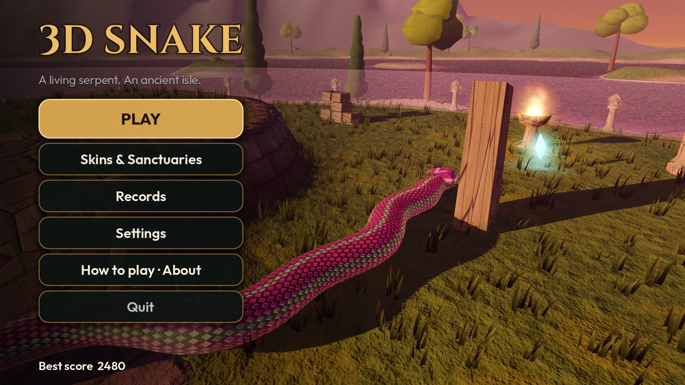 **01** Main menu (Crimson Dusk, Lotus Cobra) | 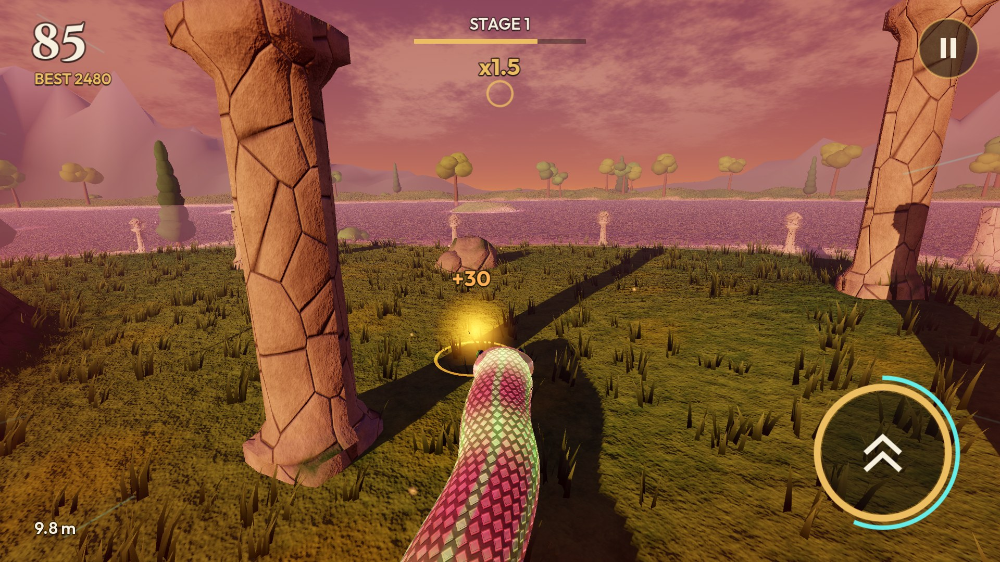 **02** Crimson Dusk: fruit between leaning pillars |
| 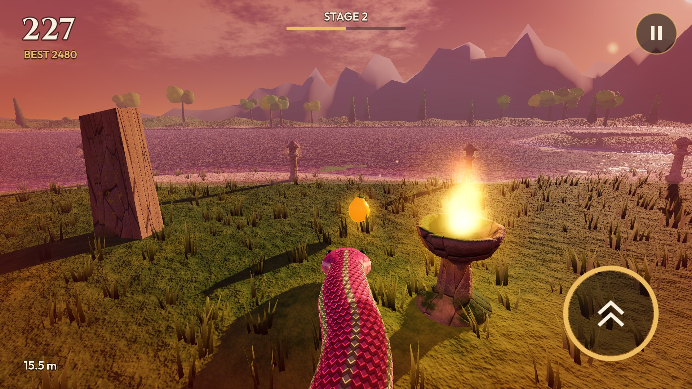 **03** Crimson Dusk: a brazier by the shore | 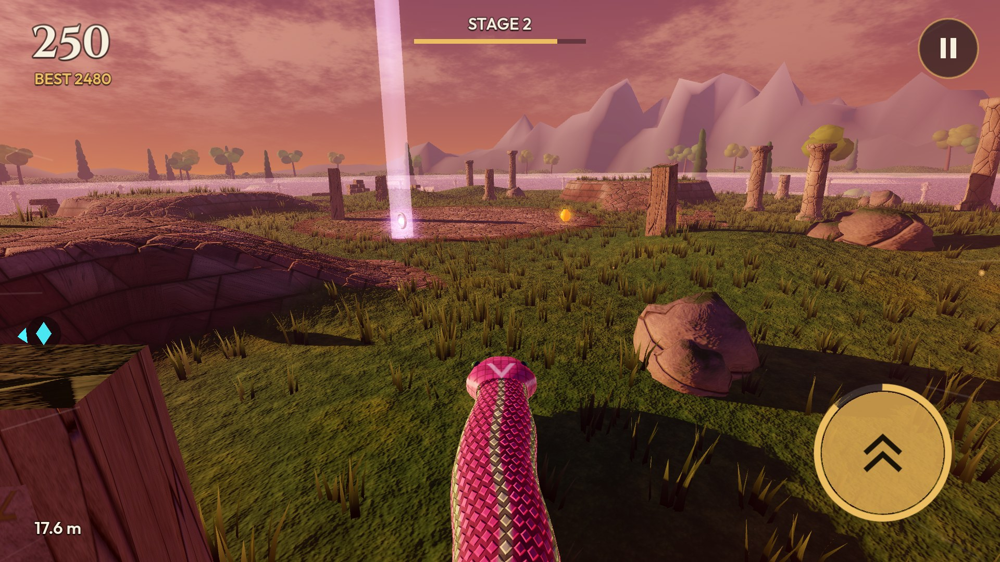 **04** Crimson Dusk: a relic beam beyond a terrace |
| 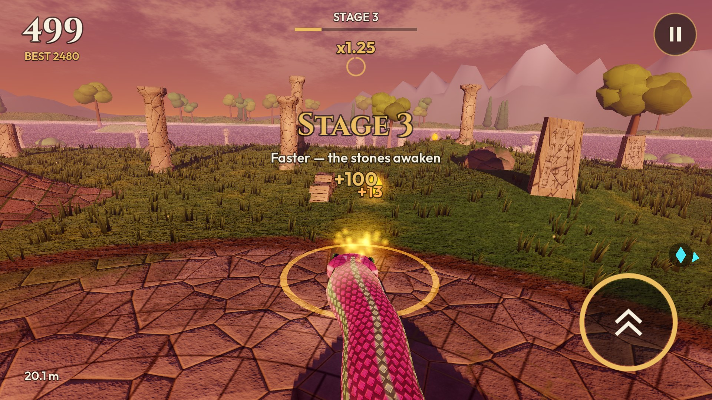 **05** Crimson Dusk: Stage 3 on a paved terrace | 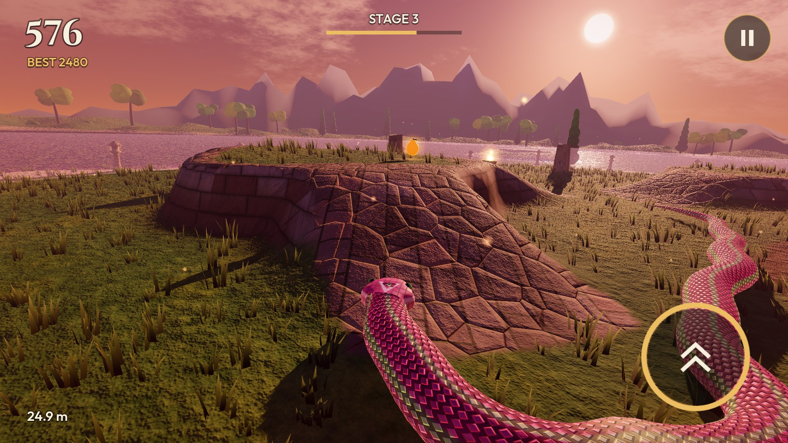 **06** Crimson Dusk: a walled terrace and its ramp |
| 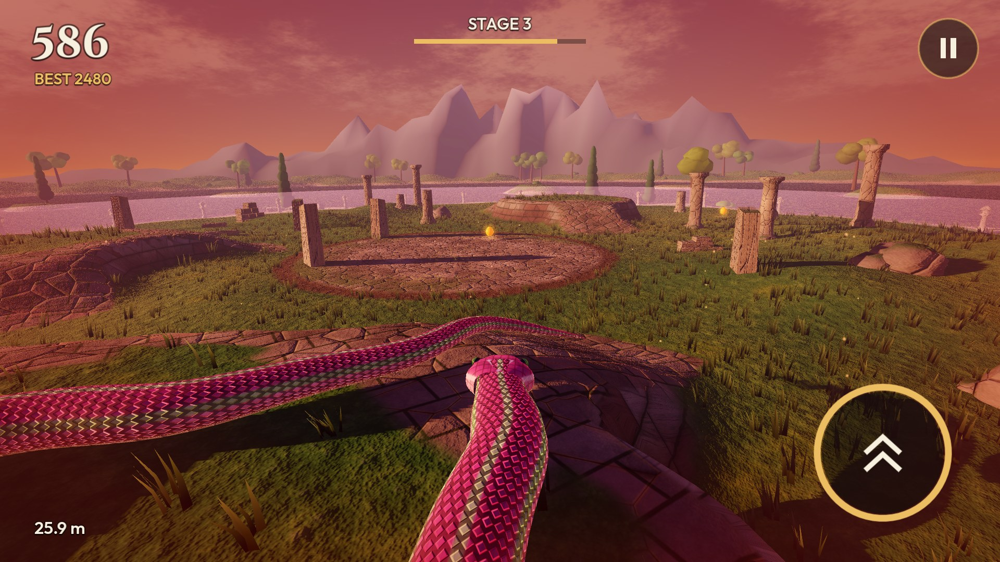 **07** Crimson Dusk: a 26 m Lotus Cobra | 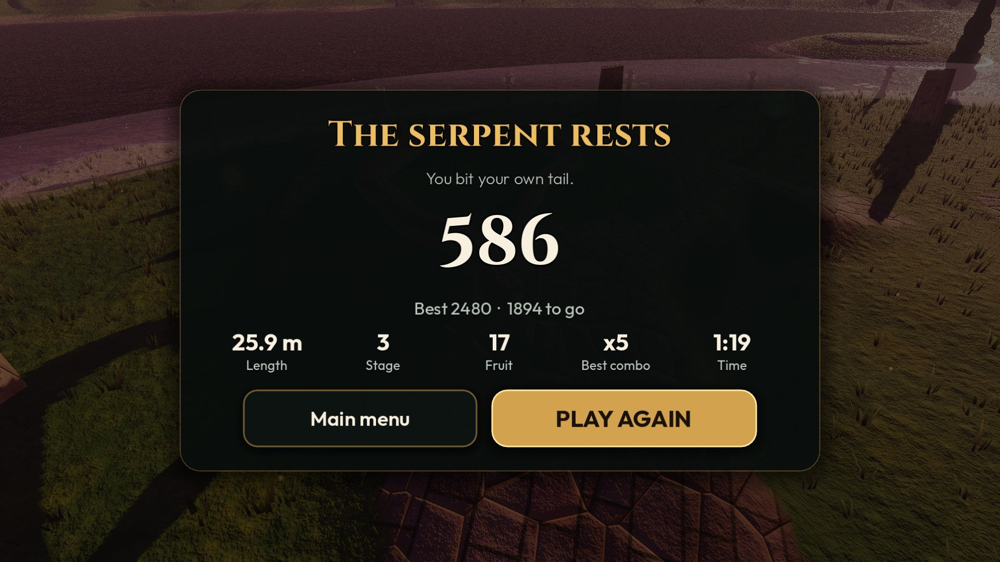 **08** Game over |
| 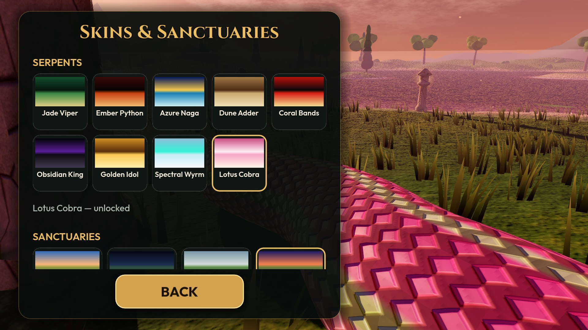 **09** Skins & Sanctuaries: 9 serpents, 4 sanctuaries | 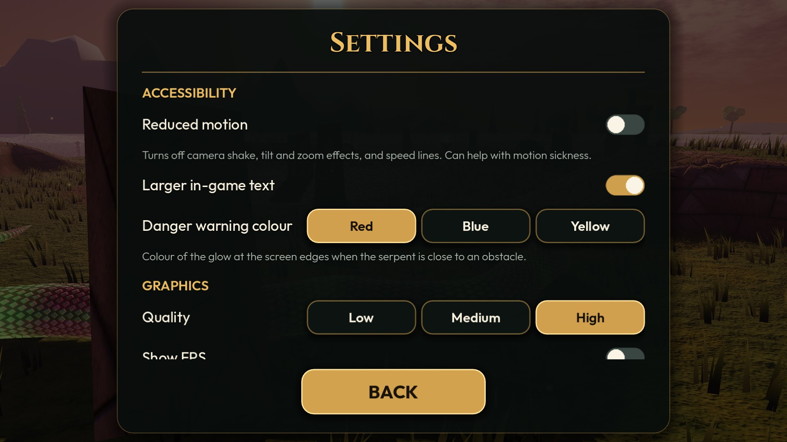 **10** Settings: larger in-game text, danger colour |
| 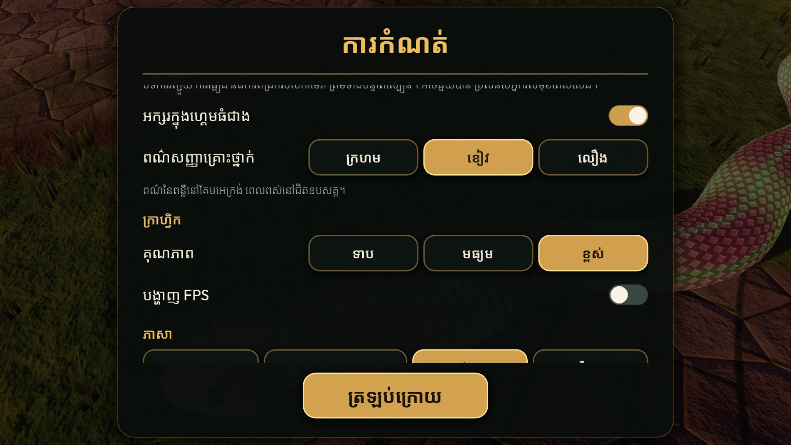 **11** Khmer: the new accessibility settings | 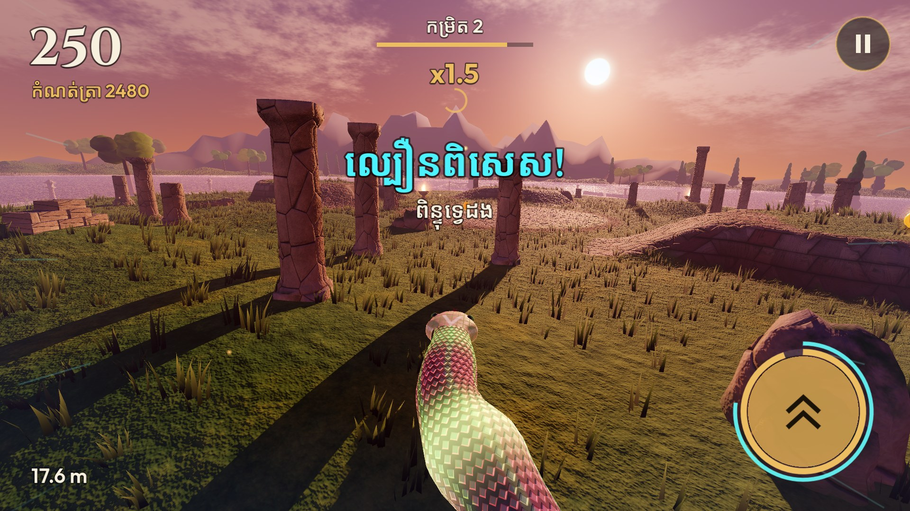 **12** Khmer, larger in-game text: Surge |
| 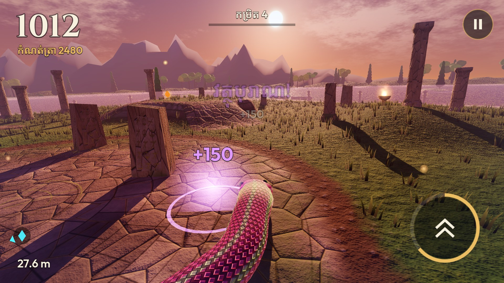 **13** Khmer, larger in-game text: relic collected | 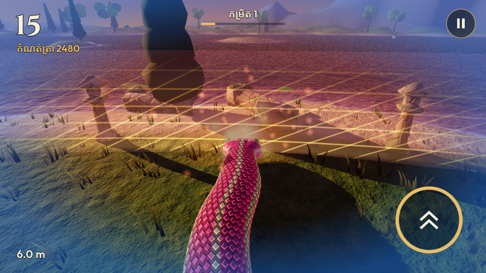 **14** Danger glow set to blue, at the island's barrier |
| 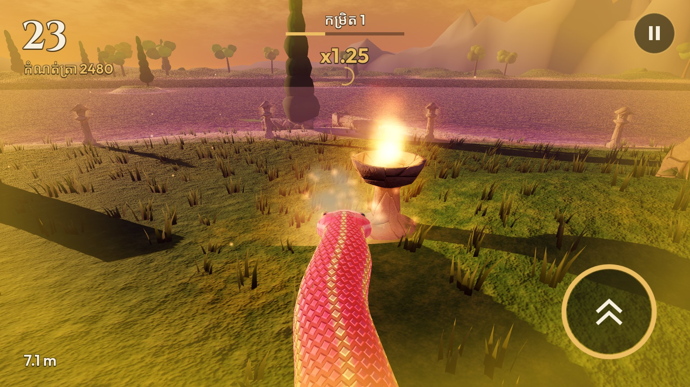 **15** Danger glow set to yellow, next to a brazier |  |

Earlier versions: see [the screenshot history](../README.md).
