# 3D Snake 1.4.0 — screenshots

Captured on 2026-11-11 from version 1.4.0 (a fifth sanctuary, Jade Monsoon, on its own island; a
tenth skin, Amethyst Krait). 1920×1080, high quality setting, Android emulator (OpenGL renderer),
with the autopilot playing the run in the Showcase build. Free to use for documentation, store
pages and presentations. `overview.jpg` is a captioned contact sheet of all 14. The four older
islands are unchanged: see [v1.3](../v1.3/README.md) and [v1.2](../v1.2/README.md).

| | |
|---|---|
| 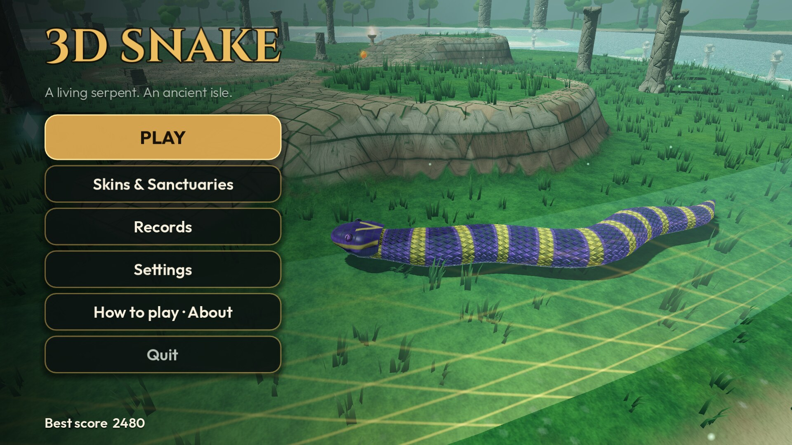 **01** Main menu (Jade Monsoon, Amethyst Krait) | 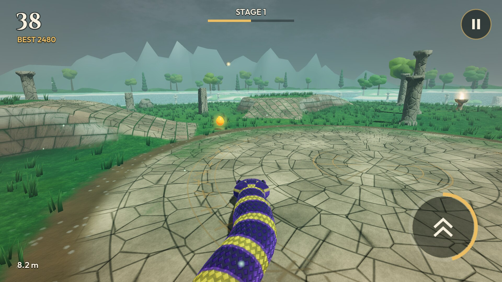 **02** Jade Monsoon: fruit on a paved terrace |
| 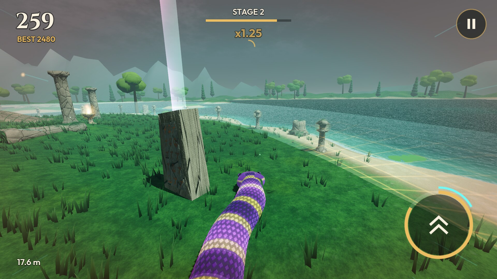 **03** Jade Monsoon: a relic beam behind a monolith | 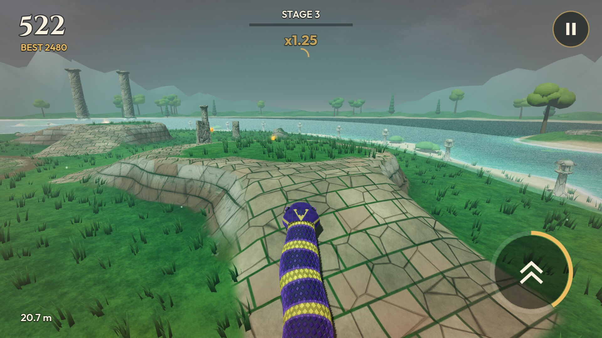 **04** Jade Monsoon: a paved ramp up a terrace |
| 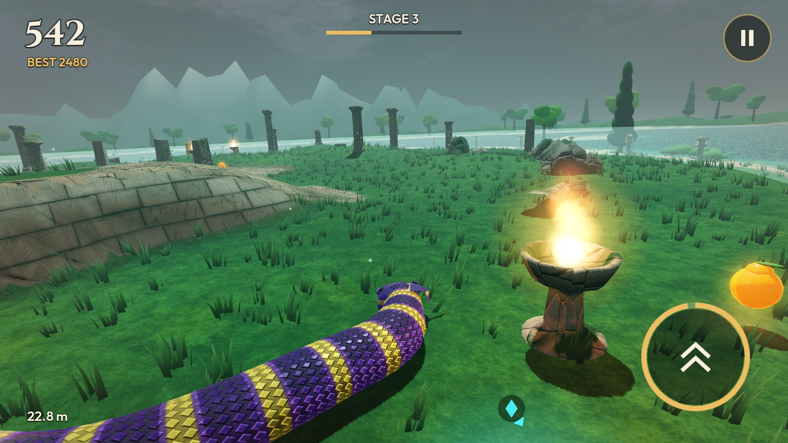 **05** Jade Monsoon: a brazier and a sunfruit | 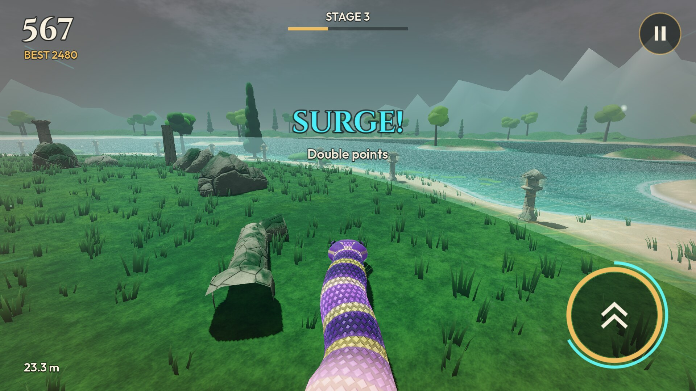 **06** Jade Monsoon: Surge by the shore |
| 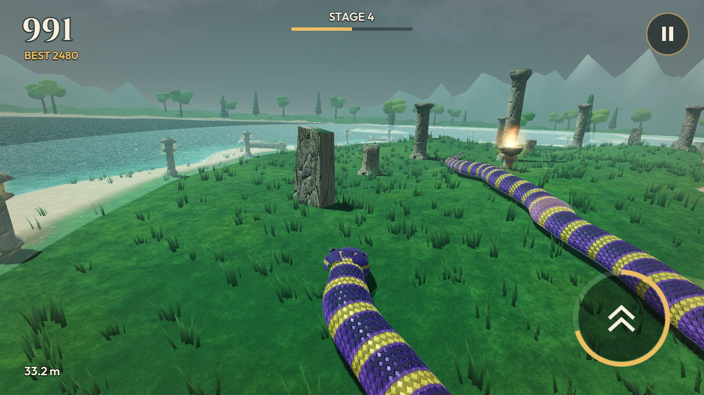 **07** Jade Monsoon: a 33 m Amethyst Krait | 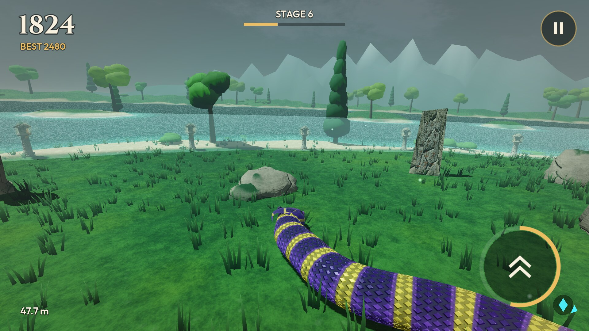 **08** Jade Monsoon: Stage 6, 48 m |
| 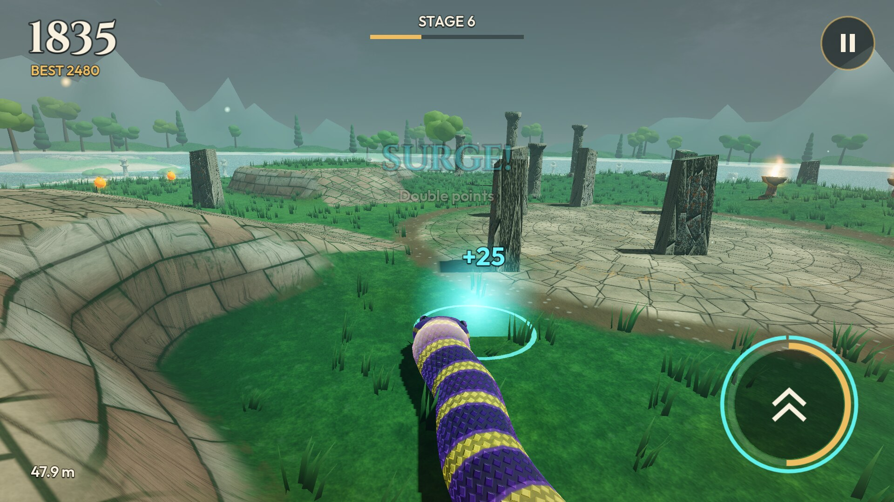 **09** Jade Monsoon: a Surge crystal collected | 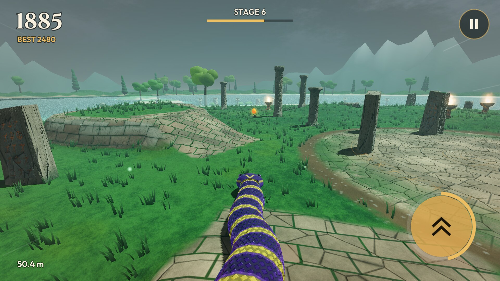 **10** Jade Monsoon: boosting up a ramp |
| 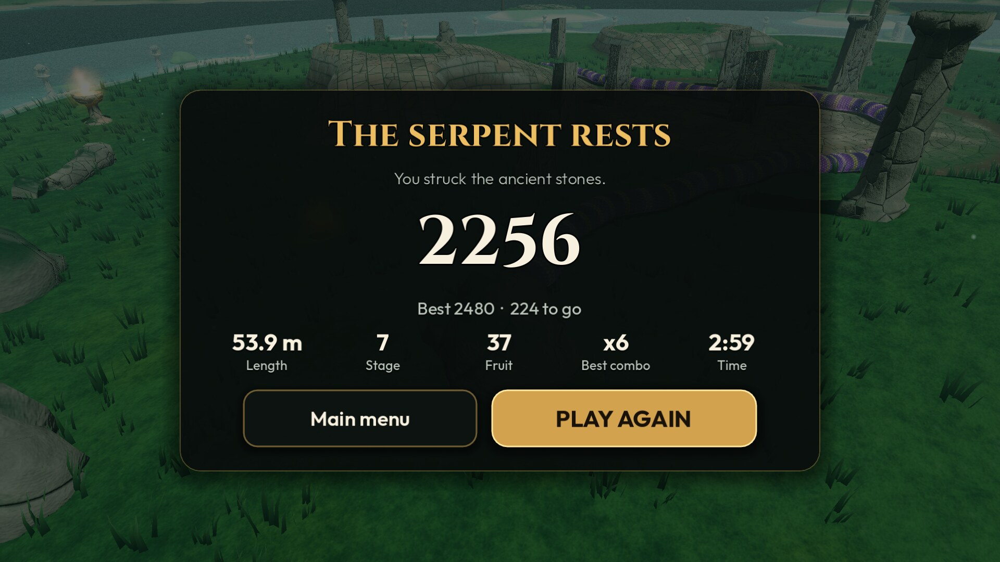 **11** Game over | 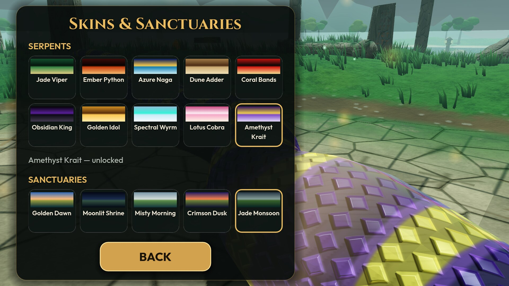 **12** Skins & Sanctuaries: 10 serpents, 5 sanctuaries |
| 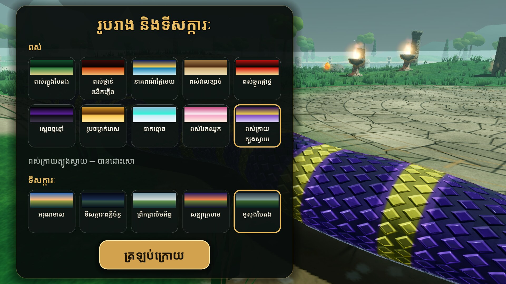 **13** Khmer: Skins & Sanctuaries | 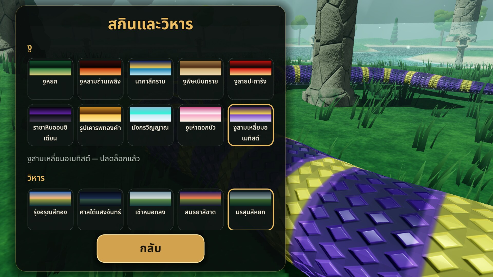 **14** Thai: Skins & Sanctuaries |

Earlier versions: see [the screenshot history](../README.md).
