# 3D Snake 1.5.0 — screenshots

Captured on 2026-11-11 from version 1.5.0 (a sixth sanctuary, Silver Frost, on its own island; an
eleventh skin, Pearl Naga). 1920×1080, high quality setting, Android emulator (OpenGL renderer),
with the autopilot playing the run in Showcase mode. Free to use for documentation, store
pages and presentations. `overview.jpg` is a captioned contact sheet of all 15. The five older
islands are unchanged: see [v1.4](../v1.4/README.md), [v1.3](../v1.3/README.md) and
[v1.2](../v1.2/README.md).

| | |
|---|---|
| 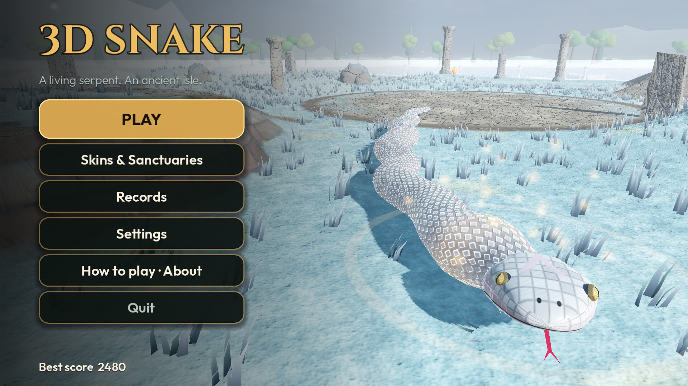 **01** Main menu (Silver Frost, Pearl Naga) | 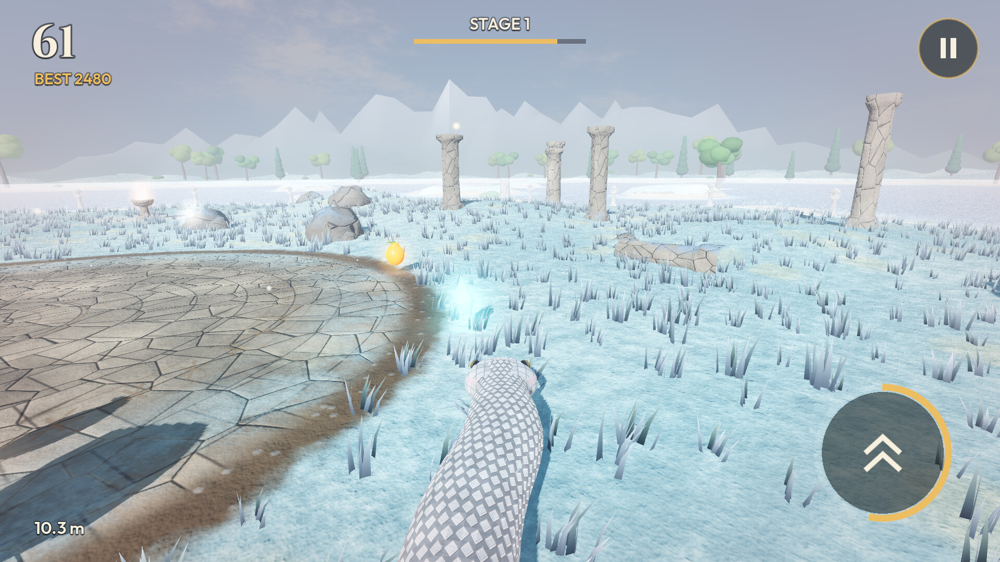 **02** Silver Frost: a Surge crystal by a paved terrace |
| 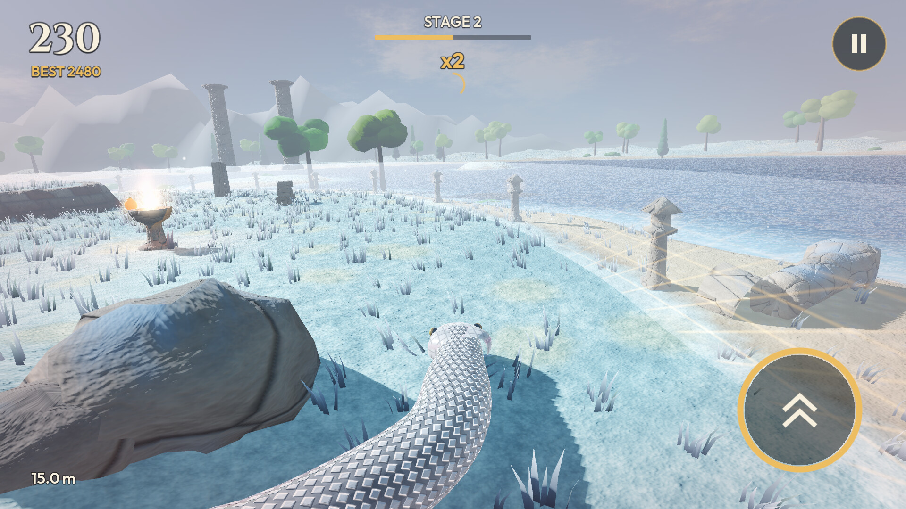 **03** Silver Frost: the shore, Stage 2 | 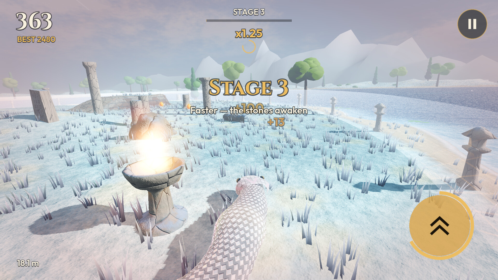 **04** Silver Frost: Stage 3 beside a brazier |
| 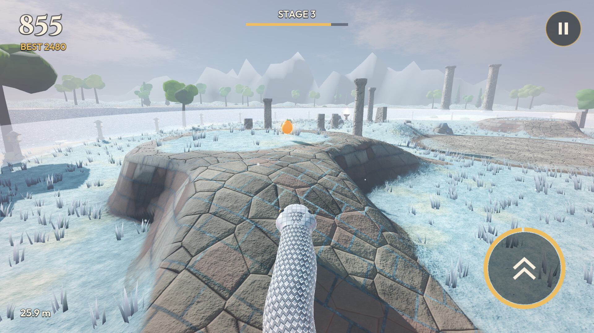 **05** Silver Frost: climbing a paved ramp | 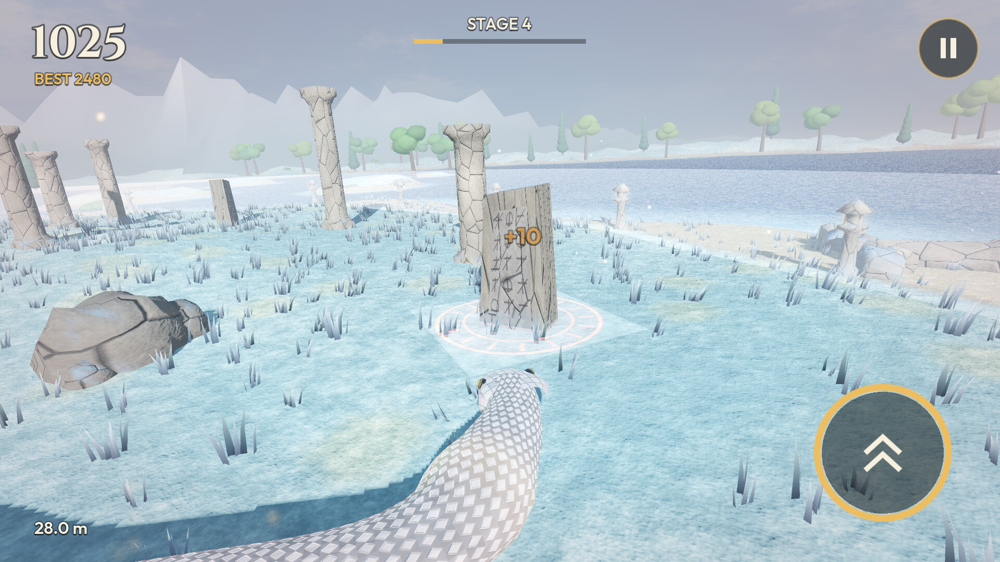 **06** Silver Frost: a monolith rising, Stage 4 |
| 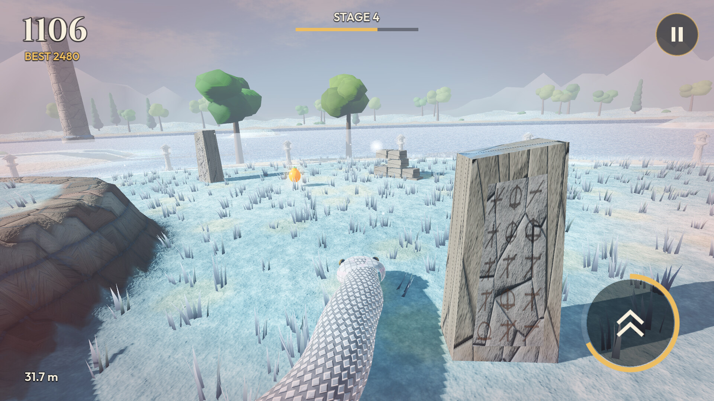 **07** Silver Frost: a carved stone, 32 m | 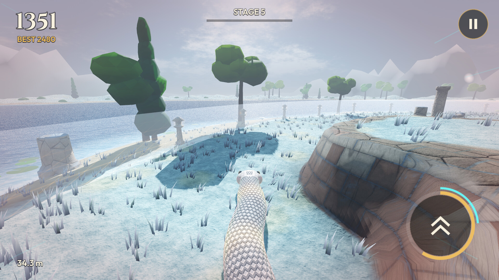 **08** Silver Frost: along a terrace wall |
| 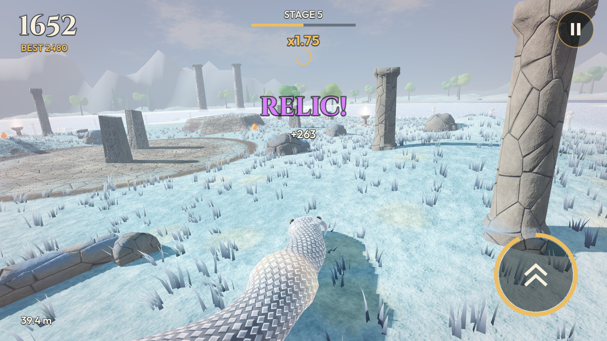 **09** Silver Frost: a relic collected | 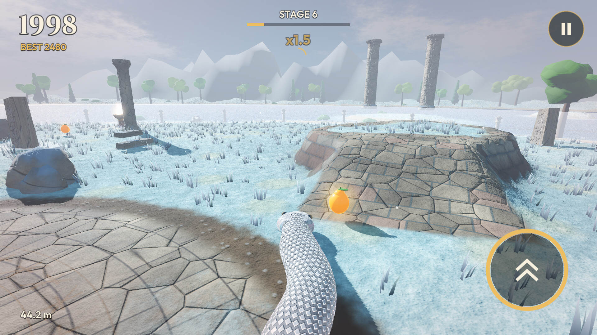 **10** Silver Frost: Stage 6, a 44 m Pearl Naga |
| 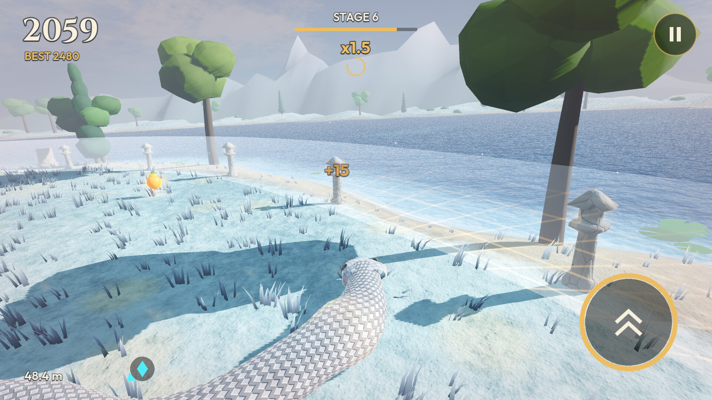 **11** Silver Frost: 48 m by the water | 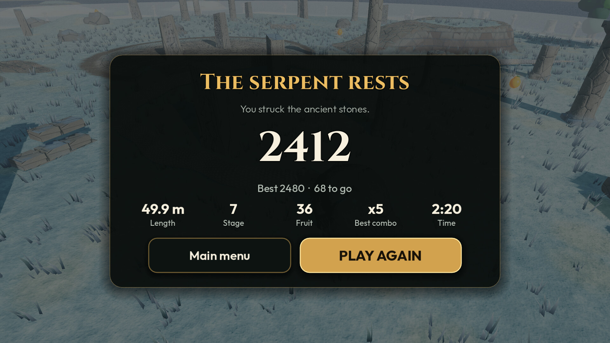 **12** Game over |
| 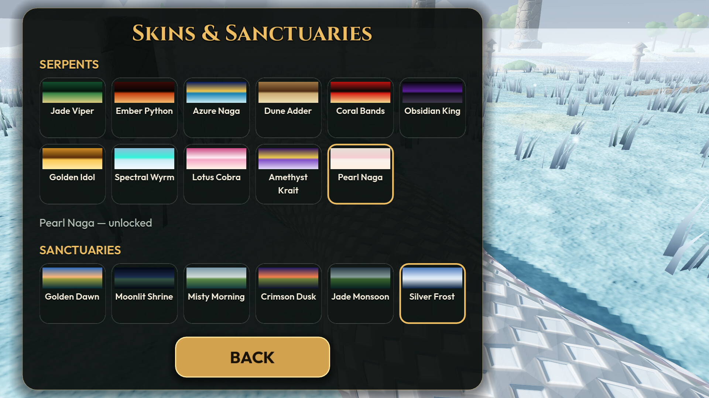 **13** Skins & Sanctuaries: 11 serpents, 6 sanctuaries | 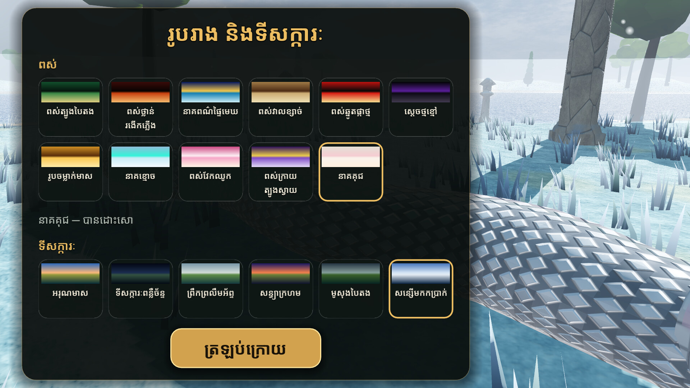 **14** Khmer: Skins & Sanctuaries |
| 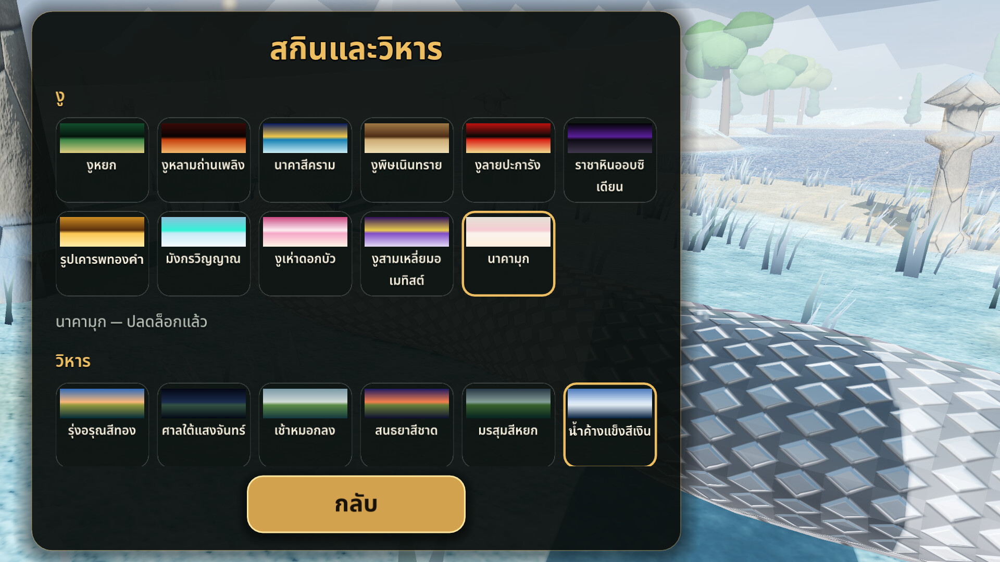 **15** Thai: Skins & Sanctuaries | |

Earlier versions: see [the screenshot history](../README.md).
