# 3D Snake 1.6.0 — screenshots

Captured on 2026-11-11 from version 1.6.0 (a seventh sanctuary, Turquoise Lagoon, on its own
island; a twelfth skin, Storm Serpent; Vietnamese). 1920×1080, high quality setting, Android
emulator (OpenGL renderer), with the autopilot playing the run in Showcase mode. Free to use for
documentation, store pages and presentations. `overview.jpg` is a captioned contact sheet of all
17. The six older islands are unchanged: see [v1.5](../v1.5/README.md), [v1.4](../v1.4/README.md),
[v1.3](../v1.3/README.md) and [v1.2](../v1.2/README.md).

| | |
|---|---|
| 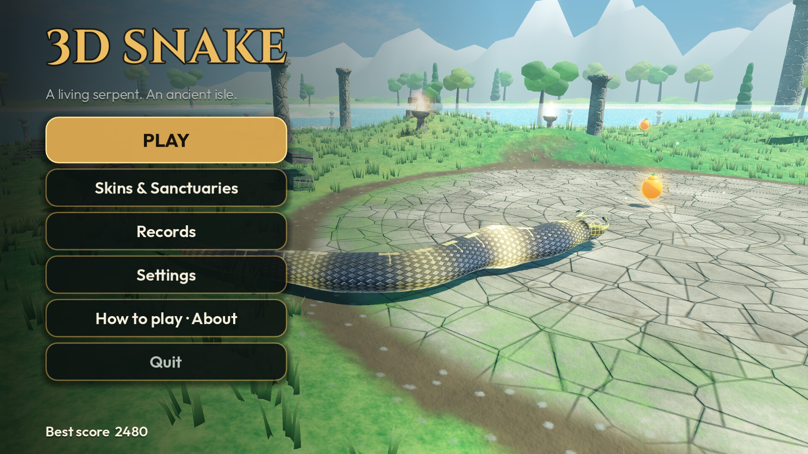 **01** Main menu (Turquoise Lagoon) | 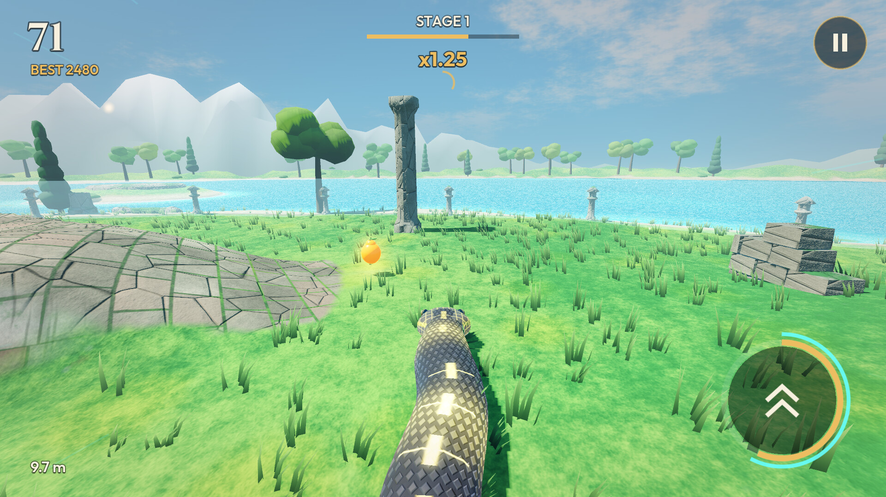 **02** Turquoise Lagoon: a sunfruit by the water |
| 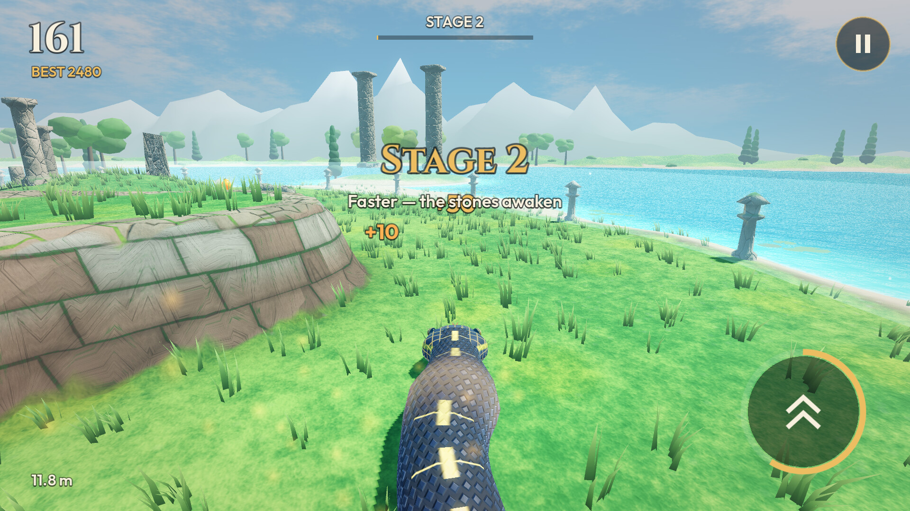 **03** Turquoise Lagoon: Stage 2 beside a terrace wall | 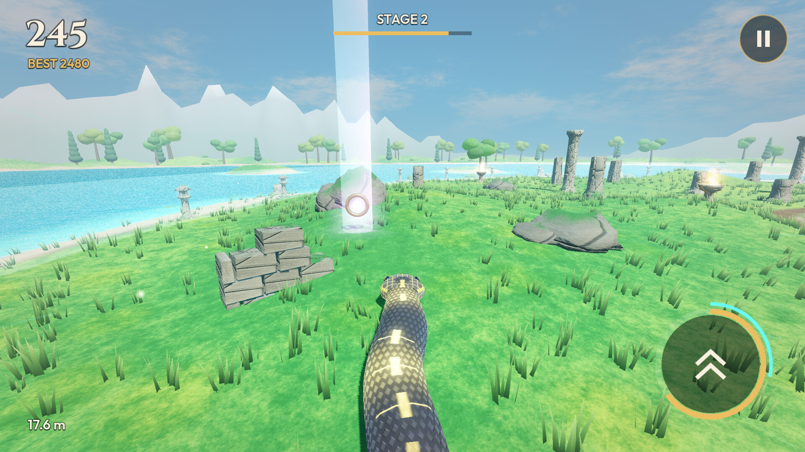 **04** Turquoise Lagoon: a relic's beam of light |
| 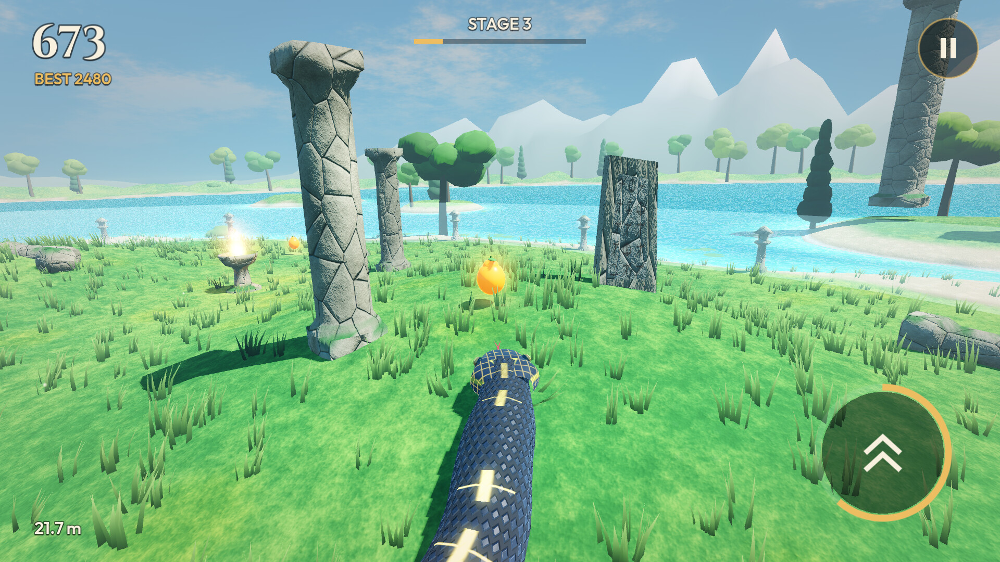 **05** Turquoise Lagoon: a brazier and a monolith | 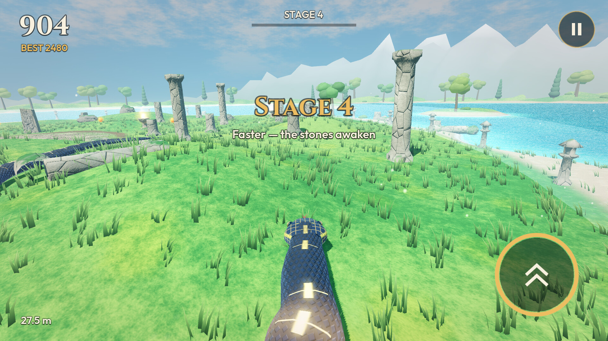 **06** Turquoise Lagoon: Stage 4 |
| 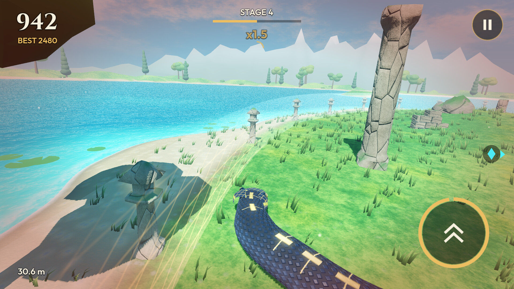 **07** Turquoise Lagoon: boosting along the beach | 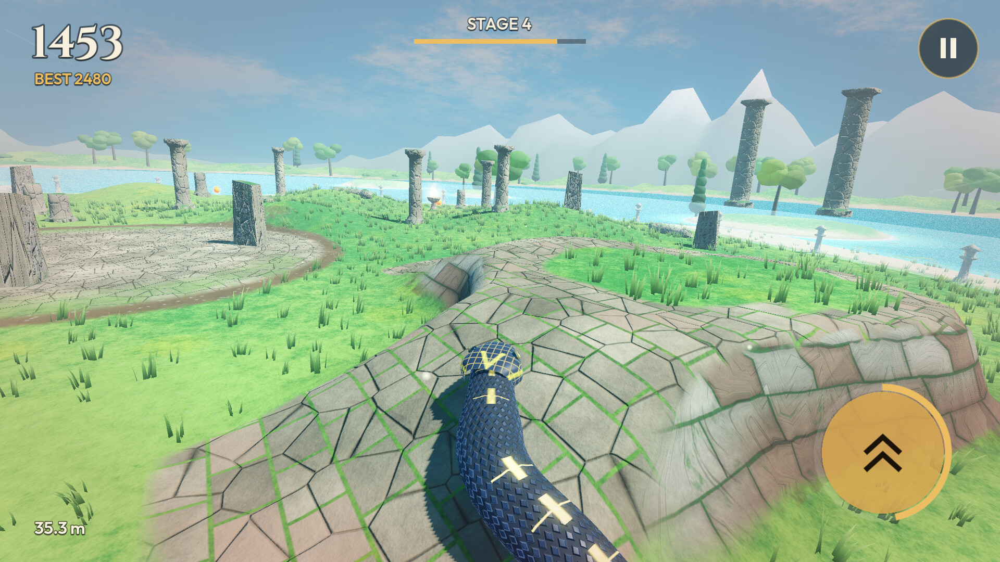 **08** Turquoise Lagoon: a paved ramp |
| 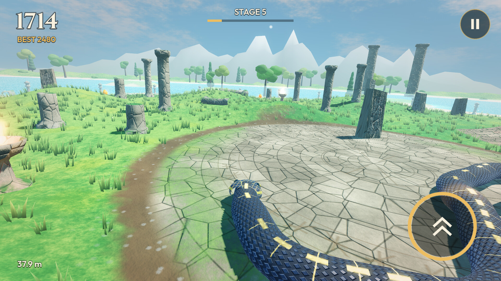 **09** Turquoise Lagoon: a 38 m Storm Serpent on a terrace | 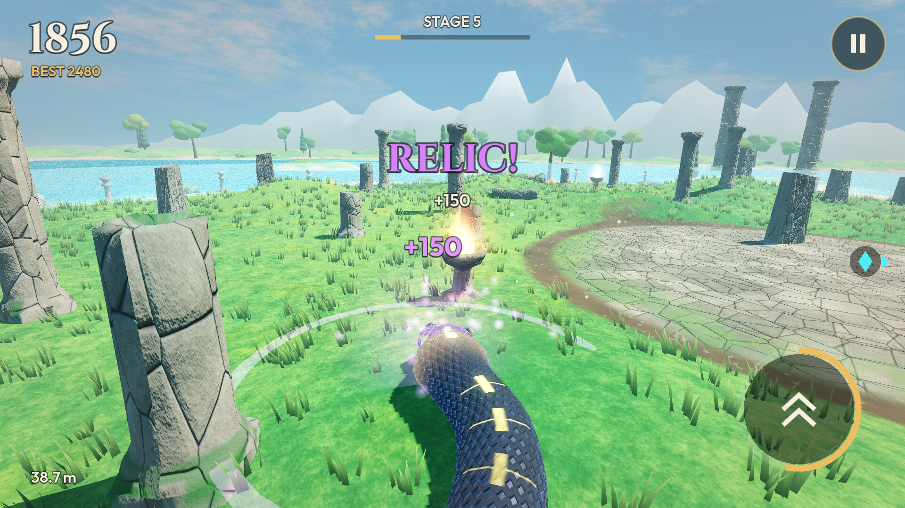 **10** Turquoise Lagoon: a relic collected |
| 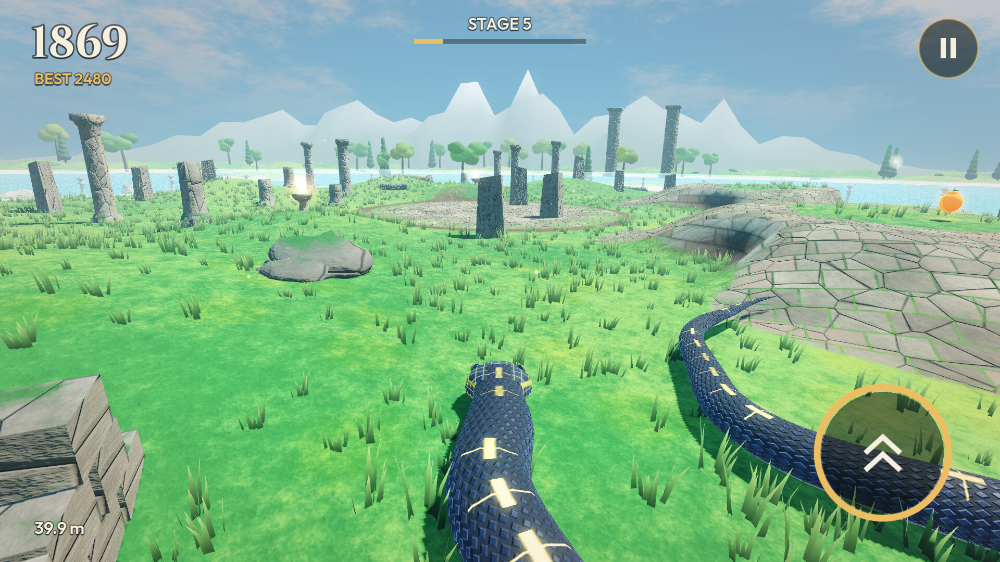 **11** Turquoise Lagoon: 40 m, Stage 5 | 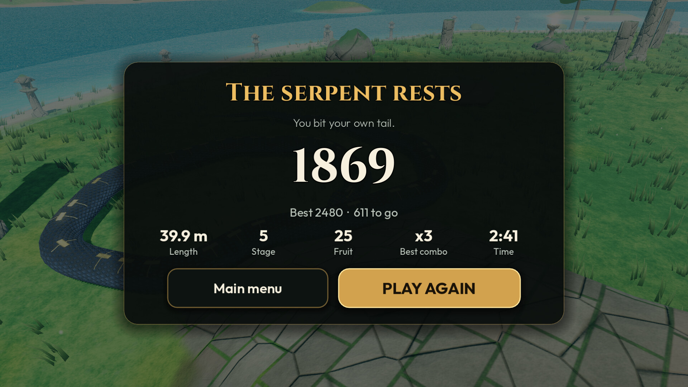 **12** Game over |
| 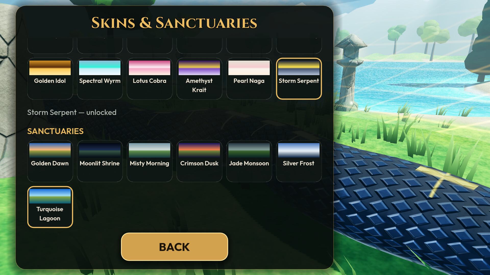 **13** Skins & Sanctuaries: 12 serpents, 7 sanctuaries (scrolled to the one in use) | 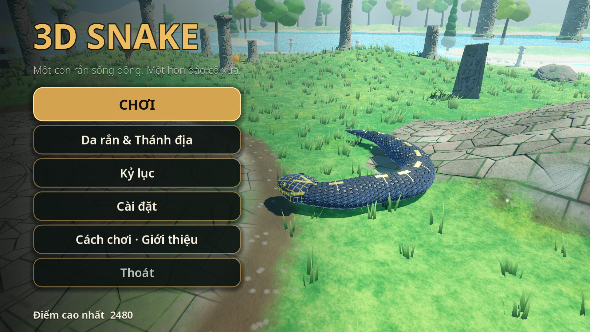 **14** Vietnamese: main menu |
| 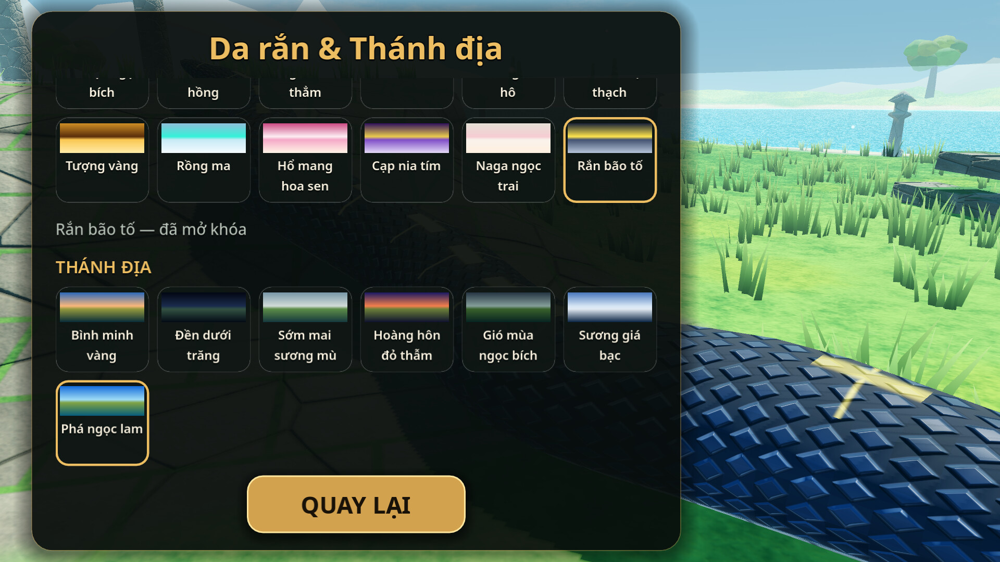 **15** Vietnamese: Skins & Sanctuaries | 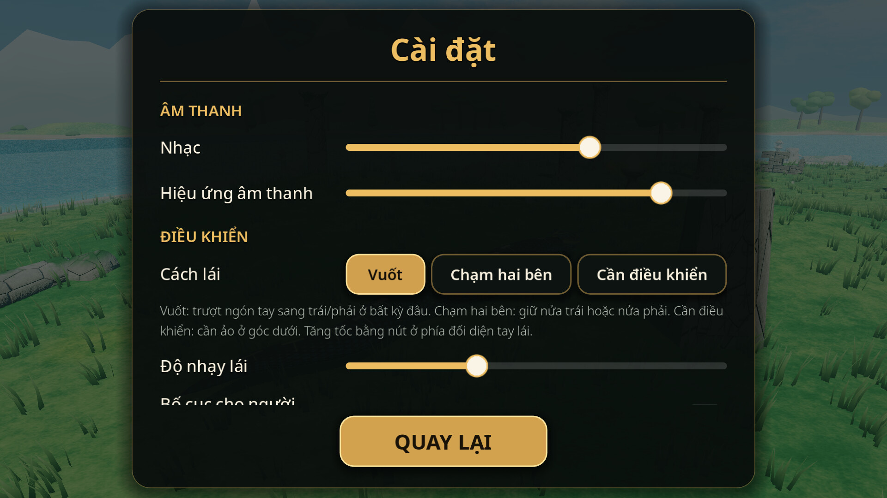 **16** Vietnamese: Settings |
| 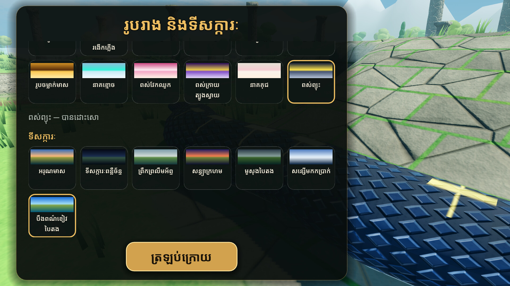 **17** Khmer: Skins & Sanctuaries | |

Earlier versions: see [the screenshot history](../README.md).
