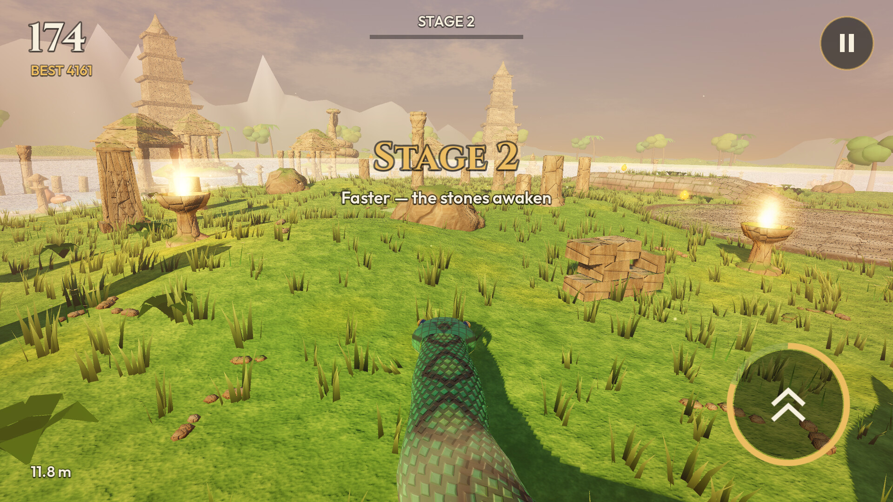
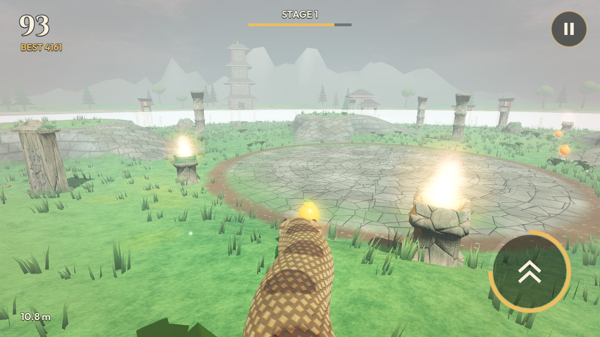
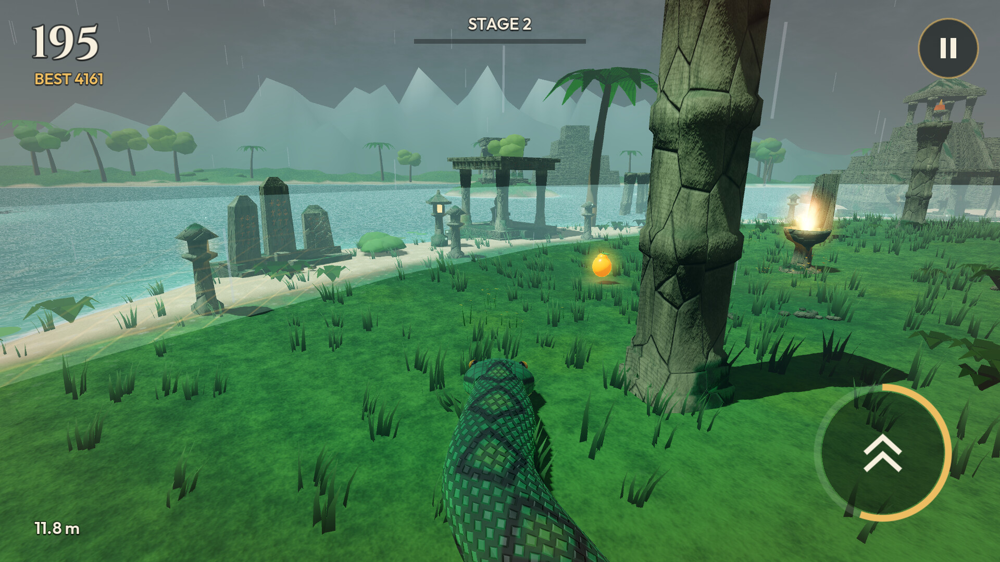
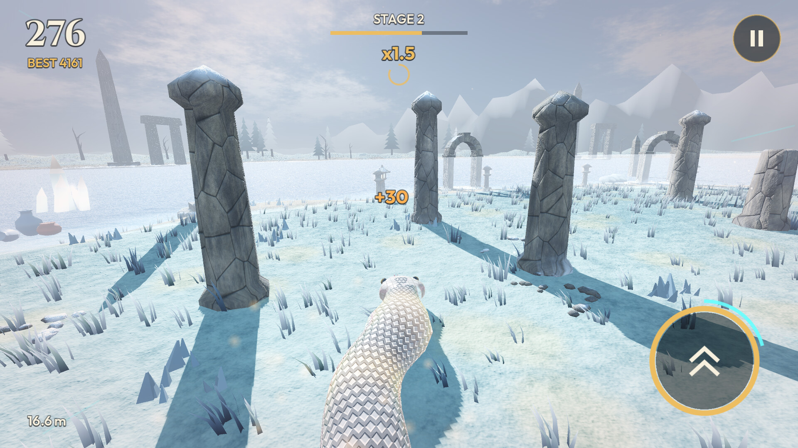
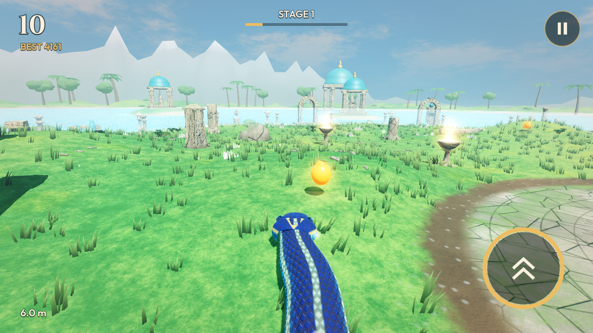
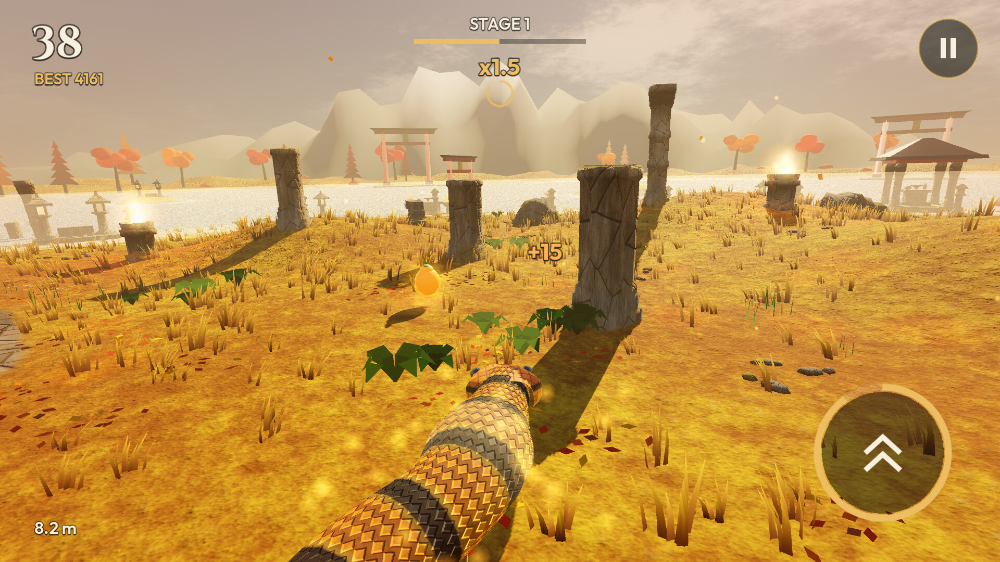
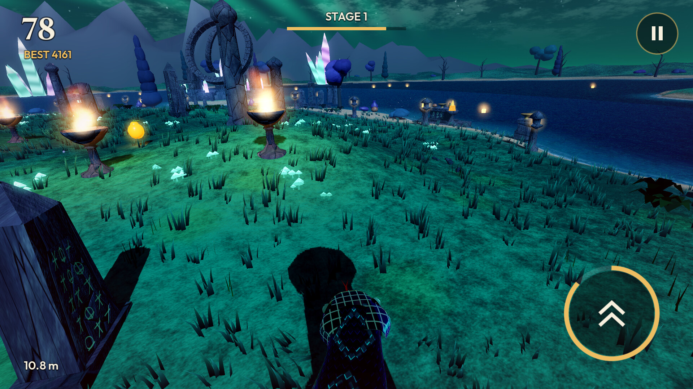
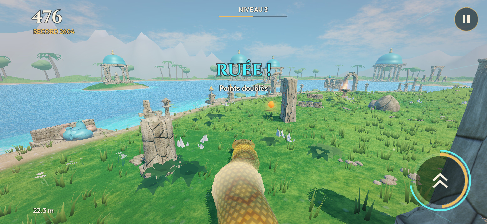

# 3D Snake 2.1.0 — screenshots

Captured on 2026-11-12 from version 2.1.0 (the playfield's monoliths and braziers take the
sanctuary's shape). Images 01 to 07: 1920×1080, high quality setting, Android emulator (OpenGL
renderer), the autopilot playing. Image 08 was taken on a Samsung Galaxy A56 (Vulkan renderer,
medium quality, 2340×1080) from version 2.0.0, during the frame-rate measurement. Free to use for
documentation, store pages and presentations. `overview.jpg` is a captioned contact sheet. The
architecture itself is shown in [v2.0](../v2.0/README.md).

| | |
|---|---|
|  **01** Golden Dawn: a stele-shaped monolith, bowl braziers |  **02** Misty Morning: a square fire-altar on the plaza |
|  **03** Jade Monsoon: steles and a shrine on the shore, in the rain |  **04** Silver Frost: faceted pillars, chalice braziers |
|  **05** Turquoise Lagoon: the start of a run |  **06** Amber Autumn: square pillars, gates on the shore |
|  **07** Violet Aurora: an obelisk monolith, chalice braziers |  **08** On the Galaxy A56 (Vulkan): Turquoise Lagoon, 2.0.0 |

Earlier versions: see [the screenshot history](../README.md).
